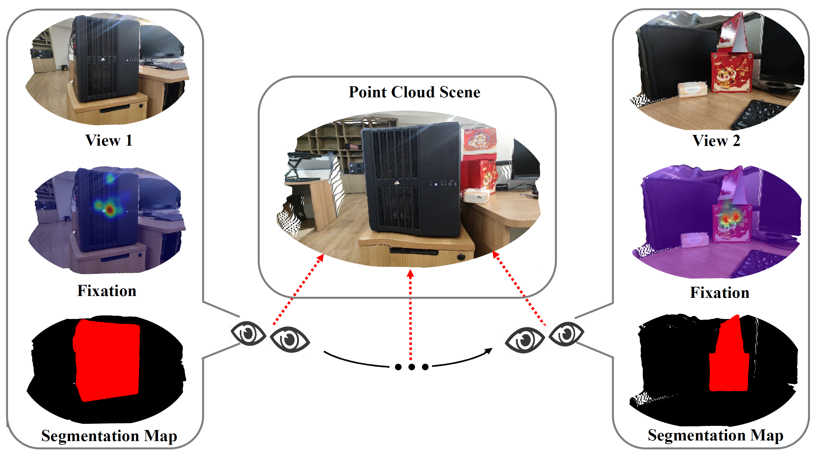
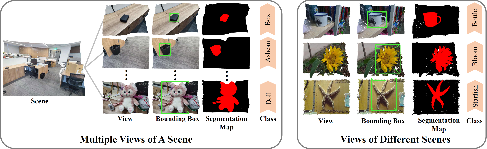

# Salient Object Detection for Point Clouds (ECCV 2022) <a name="headin"></a>
Citation:
Songlin Fan, Wei Gao*, Ge Li, "Salient Object Detection for Point Clouds," ECCV 2022.

Contact:
Please contact slfan@pku.edu.cn if having any questions.

### :fire: NEWS
- [2022/07/24] :boom:Add one-key evaluation toolbox.
- [2022/07/04] Create the project.

<p align="center">
     <br/>
    <em> 
Figure 1: Illustration of point cloud salient object detection.
</em>
</p>

### Catalog
- [Abstract](#abstract)
- [PCSOD](#pcsod-dataset)
- [Reproduction](#reproduction)
- [One-key Evaluation](#one-key-evaluation)
- [Benchmark](#benchmark)
- [Citation](#citation)
- [Acknowledgement](#acknowledgement)


### Abstract
This paper researches the unexplored task-point cloud salient object detection (SOD). Differing from SOD for images, we find the attention shift of point clouds may provoke saliency conflict, i.e., an object paradoxically belongs to salient and non-salient categories. To eschew this issue, we present a novel view-dependent perspective of salient objects, reasonably reflecting the most eye-catching objects in point clouds. Following this formulation, we introduce PCSOD, the first dataset proposed for point cloud SOD consisting of 2,872 in-/out-door 3D views. The samples in our dataset are labeled with hierarchical annotations, e.g., super-/sub-class, bounding box, and segmentation map, which endows the brilliant generalizability and broad applicability of our dataset verifying various conjectures. To evidence the feasibility of our solution, we further contribute a baseline model and benchmark five representative models for comprehensive comparisons. The proposed model can effectively analyze irregular and unordered points for detecting salient objects. Thanks to incorporating the task-tailored designs, our method shows remarkable superiority over other baseline models. Extensive experiments and discussions reveal the promising potential of this research field, paving the way for further study.

### PCSOD dataset
<a href="https://creativecommons.org/licenses/by-nc-nd/4.0/"></a> Usage of our dataset is under the Creative Commons Attribution-NonCommercial-NoDerivatives 4.0 International Public License. 

<p align="center">
     <br/>
    <em> 
    Figure 2: Visual examples from our PCSOD dataset with hierarchical annotations.
    </em>
</p>

**Dataset** | **Year** | **Pub.** |**Size** | **#training** | **#Testing** | **Download**
  :----: | :----: | :----:  | :----:  | :----:| :----: | :----: |
  **PCSOD**   |2022 |ECCV   | 2872 | 2000  |872 | [Baidu Pan](https://pan.baidu.com/s/1EBLY50zQgr8vHM6NFjoQug?pwd=skto) [code: skto]

  Note: 3D views and annotated segmentation maps are .ply files, while bounding boxes are .npy files containing their (x,y,z) coordinates of the eight vertices in space.

### Reproduction
First, prepare your Anaconda environment following the file named “pcsod.yml”. Then, download our PCSOD dataset from [Baidu Pan](https://pan.baidu.com/s/1EBLY50zQgr8vHM6NFjoQug?pwd=skto) [code: skto] and the trained model from  [Baidu Pan](https://pan.baidu.com/s/1_ixpsy16oBikqsrPceG4-w) [code: skto], and put them under the following directory:

```
code\
├── Data\
│  ├── train\
|  └── test\
├── log\
|  ├── pcsod\
|     ├── logs\
|     └── checkpoints\
|        └── best_model.pth
├── train.py
├── test.py
└──...
```

Test our model while saving predictions. For a convenient comparison, you can also obtain our off-shelf predictions from [Baidu Pan](https://pan.baidu.com/s/1FK2c8oGTnKfMcwlLdfv54A) [code: skto]. We recommend using [CloudCompare](http://www.cloudcompare.org/main.html) to browse our dataset, as well as the predictions.
```
python test.py --log_dir pcsod

```
Retrain our model
```
python train.py
```
### One-key Evaluation
A One-key point cloud SOD evaluation toolbox adapted from the image-based version [Evaluate SOD](https://github.com/Hanqer/Evaluate-SOD). Put the predictions and groundtruths under the following directory:
```
one-key evaluation\ 
├── gt\
│   ├── PCSOD\ 
│       ├── test_0000.ply
│       └── test_0001.ply
│   
└── pred\
    └── PointNet\
        ├── PCSOD\ 
│          ├── test_0000.ply
│          └── test_0001.ply
├── main.py 
└──...   
```
 Usage:

 ```
 python main.py
 ```

### Benchmark
This will be a constantly updated benchmark. **Note that** the performance of methods here may vary slightly from that in our paper, which results from the conversion from 4-byte '.npy' to  8-byte '.ply'.

**Method** | **Pub.** | **MAE** |**F-measure** | **E-measure** | **IoU** | **Results**
:----: | :----: | :----:  | :----:  | :----:| :----: | :----: |
[PointSal (Ours)](https://arxiv.org/pdf/2207.11889.pdf)   |ECCV'22 | .068 | .772 | .853  |.658 | [Baidu Pan](https://pan.baidu.com/s/1FK2c8oGTnKfMcwlLdfv54A) [code: skto]
[PointNet](https://openaccess.thecvf.com/content_cvpr_2017/papers/Qi_PointNet_Deep_Learning_CVPR_2017_paper.pdf) |CVPR'17 | .116 | .634 | .770  |.520 | [Baidu Pan](https://pan.baidu.com/s/19EJgElSddwaonI5KoRLLUw) [code: skto] 
[PointNet2](https://proceedings.neurips.cc/paper/2017/file/d8bf84be3800d12f74d8b05e9b89836f-Paper.pdf) |NeurIPS'17 | .077 | .741 | .817  |.610 | [Baidu Pan](https://pan.baidu.com/s/1KFZ75TkdK4INgPBlO_ufFQ) [code: skto]
[PointCNN](https://proceedings.neurips.cc/paper/2018/file/f5f8590cd58a54e94377e6ae2eded4d9-Paper.pdf) |NeurIPS'18 | .150 | .244 | .412  |.152 | [Baidu Pan](https://pan.baidu.com/s/1NHVS9hpXaBSY3G2Z0oYDzQ) [code: skto] 
[ShellNet](https://openaccess.thecvf.com/content_ICCV_2019/papers/Zhang_ShellNet_Efficient_Point_Cloud_Convolutional_Neural_Networks_Using_Concentric_Shells_ICCV_2019_paper.pdf) |ICCV'19 | .073 | .756 | .850  |.650 | [Baidu Pan](https://pan.baidu.com/s/1St0lSvmbtt2cGe_SM-M-fw) [code: skto] 
[RandLA](https://ieeexplore.ieee.org/abstract/document/9440696?casa_token=3Os3m_8LOHgAAAAA:W-Qv-RooJyhaiOogYqi05Lqw8luMAXUQybPWHlin35ad-ZGUEb_l9l6fz6Trt2Dm5atuv7w_AeuI) |TPAMI'21 | .127 | .635 | .742  |.519 | [Baidu Pan](https://pan.baidu.com/s/1OunIHGo3QMISqRujT4W8xA) [code: skto] 
  

### Citation
Please cite our paper if you find our work is helpful.
```
@inproceedings{fan2022salient,
  title={Salient Object Detection for Point Clouds},
  author={Fan, Songlin and Gao, Wei and Li, Ge},
  booktitle={European Conference on Computer Vision},
  pages={1--19},
  year={2022},
  organization={Springer}
}
```


### Acknowledgement
Our codes are built upon [PointNet](https://github.com/yanx27/Pointnet_Pointnet2_pytorch), [RandLA-Net](https://github.com/QingyongHu/RandLA-Net), and [Evaluate SOD](https://github.com/Hanqer/Evaluate-SOD). 